# BIG LAKE Gestão

**Sistema de gestão para Windows, que funciona sem internet, feito sob medida para uma sorveteria de verdade.** Controla vendas, estoque, produção, despesas e, principalmente, **quanto a loja realmente lucra**: o custo e a margem de cada produto e o lucro do mês, já dividido entre os sócios.

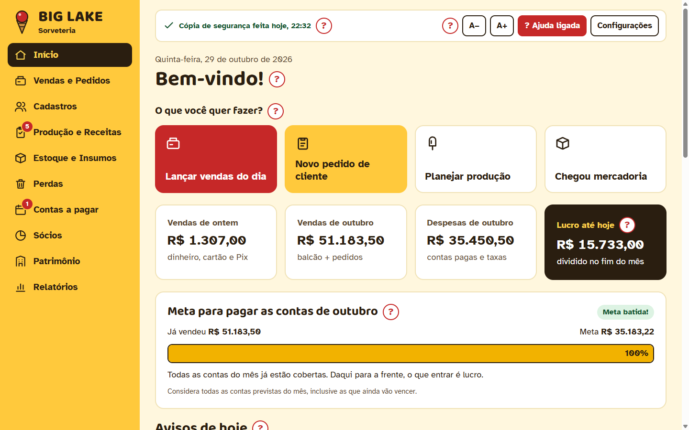

> Electron · React · TypeScript · SQLite · Vitest · Playwright
> 413 testes de unidade e integração · 80 testes ponta a ponta · instalador `.exe`

---

## O problema

A sorveteria produz paletas, picolés, sorvete de pote e açaí, e vende no balcão e no atacado (mercados, padarias, lanchonetes). O sócio que cuida das contas é uma **pessoa idosa**, que anotava tudo em papel e não sabia responder à pergunta mais importante: *"depois de pagar ingredientes, embalagens, aluguel, luz e funcionários, quanto sobra de cada paleta que eu vendo?"*

As exigências do cliente moldaram o projeto:

- **Funcionar sem internet**, no computador da loja (Windows 10), instalado por um `.exe`.
- **Fácil para uma pessoa idosa**: letra grande, poucos cliques, linguagem do dia a dia, sem siglas, e ajuda em cada parte da tela.
- **Nunca perder dados**: nem se a energia cair, nem se alguém apagar algo por engano.
- **Sem login e sem caixa venda a venda**: o balcão é lançado pelo total do dia (dinheiro, Pix, débito, crédito).

## O que o sistema faz

| Área | Funcionalidades |
|---|---|
| **Vendas** | Total do balcão por dia, pedidos de atacado com comprovante impresso, resumo por dia e por mês, taxas da maquininha |
| **Receitas e custos** | Custo de cada receita a partir dos ingredientes e das embalagens (com 4 casas decimais), lucro e margem no balcão e no atacado, aviso automático quando um ingrediente fica mais caro |
| **Estoque** | Entrada de mercadoria, validade por compra (lote), estoque mínimo, baixa automática ao registrar a produção |
| **Produção e perdas** | Planejar a produção mostrando o que falta comprar, registrar o que saiu, anotar perdas e trocas em clientes |
| **Contas a pagar** | Contas que se repetem todo mês, avisos de vencimento, pagamento em cartão pessoal de um sócio (vira reembolso) |
| **Sócios** | Divisão do lucro pela participação de cada um, retiradas durante o mês, reembolsos |
| **Relatórios** | Resultado do mês, mais vendidos, formas de pagamento, comparação com o ano anterior, lucro por produto e a **"Gordurinha"** (avisa quando os aumentos de custo pedem reajuste de preços), com impressão e PDF |
| **Segurança dos dados** | Cópia automática no computador e no pen drive, restauração, histórico legível de tudo o que mudou, "Desfazer" depois de excluir |

## Telas

<table>
  <tr>
    <td width="50%">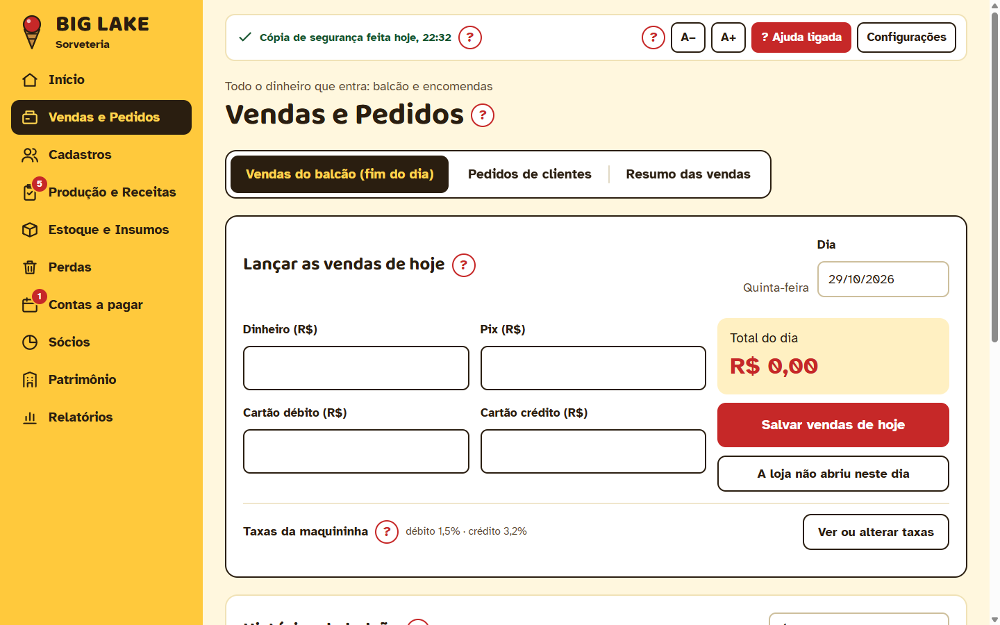<br><sub><b>Vendas do balcão</b>: o total do dia por forma de pagamento.</sub></td>
    <td width="50%">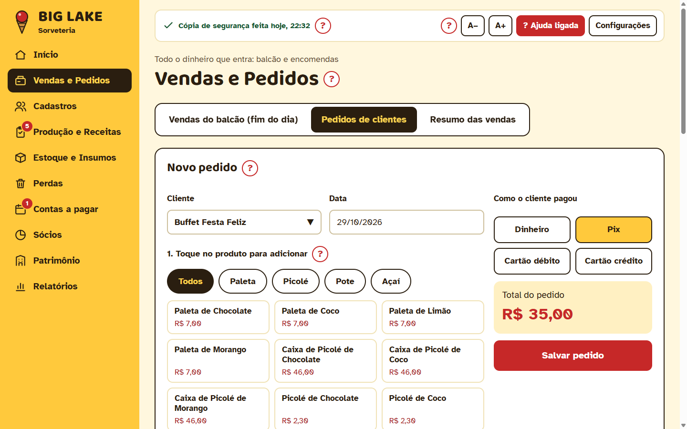<br><sub><b>Pedido de atacado</b>: toca nos produtos, o total e a taxa saem sozinhos.</sub></td>
  </tr>
  <tr>
    <td>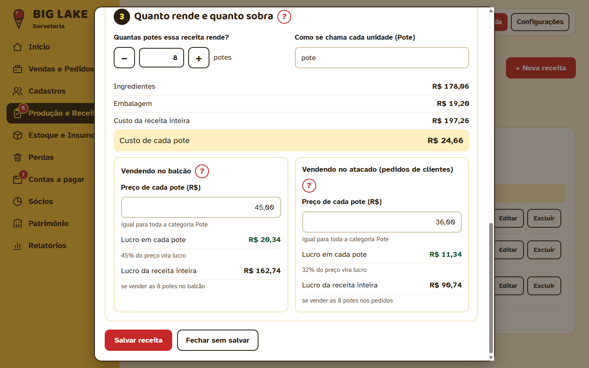<br><sub><b>Receita</b>: custo de cada unidade e quanto do preço vira lucro, ao vivo.</sub></td>
    <td>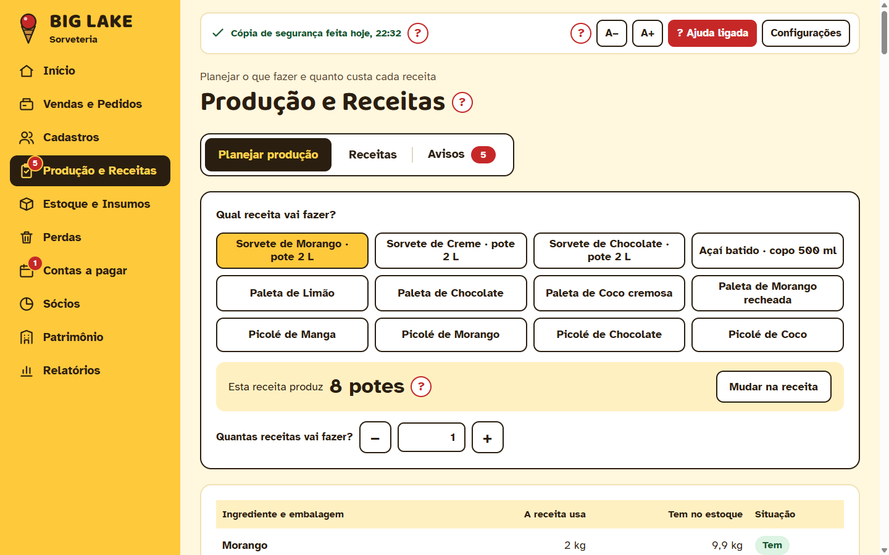<br><sub><b>Planejar produção</b>: o que a receita usa, o que tem e o que falta comprar.</sub></td>
  </tr>
  <tr>
    <td>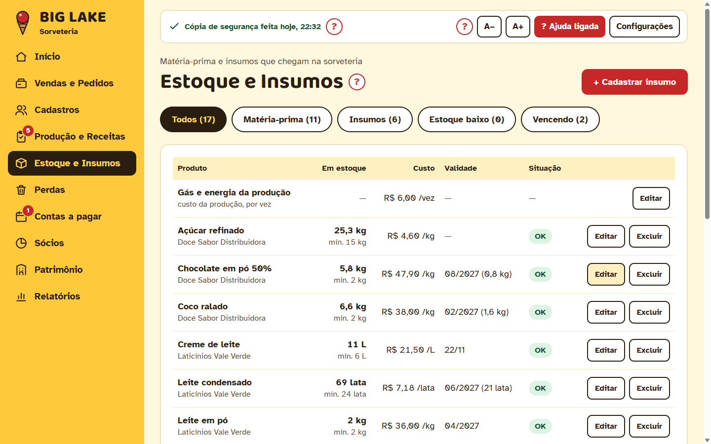<br><sub><b>Estoque</b>: validade de cada compra e situação de cada item.</sub></td>
    <td>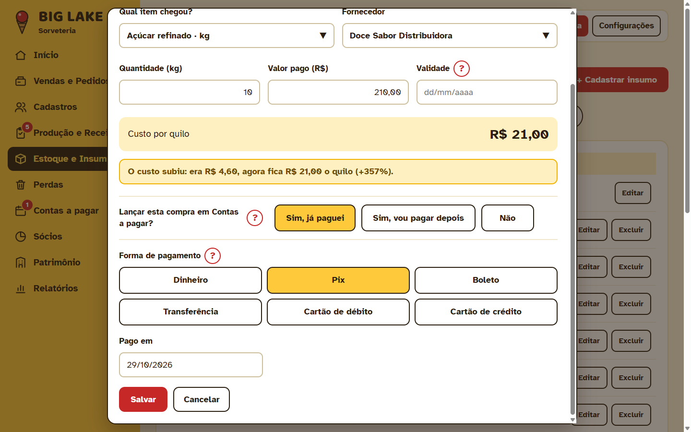<br><sub><b>Chegou mercadoria</b>: a compra já vai para Contas a pagar.</sub></td>
  </tr>
  <tr>
    <td>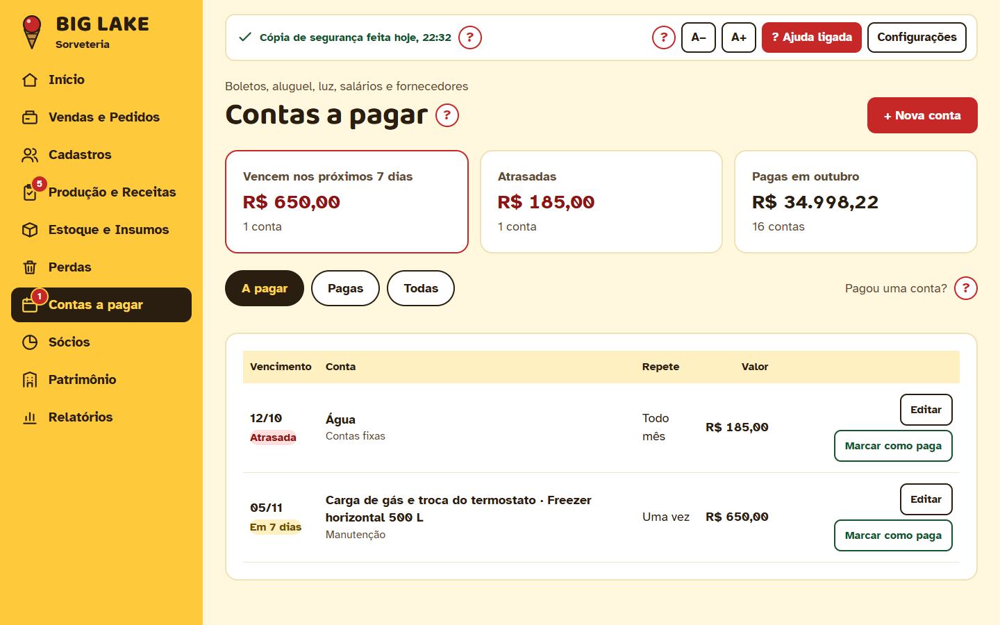<br><sub><b>Contas a pagar</b>: vencimentos, atrasadas e pagas no mês.</sub></td>
    <td>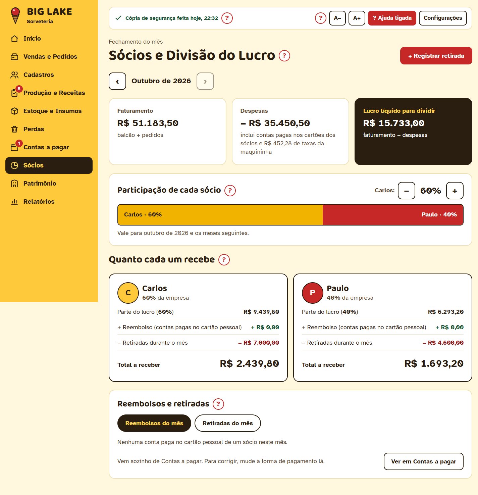<br><sub><b>Sócios</b>: lucro líquido e quanto cada um recebe.</sub></td>
  </tr>
  <tr>
    <td>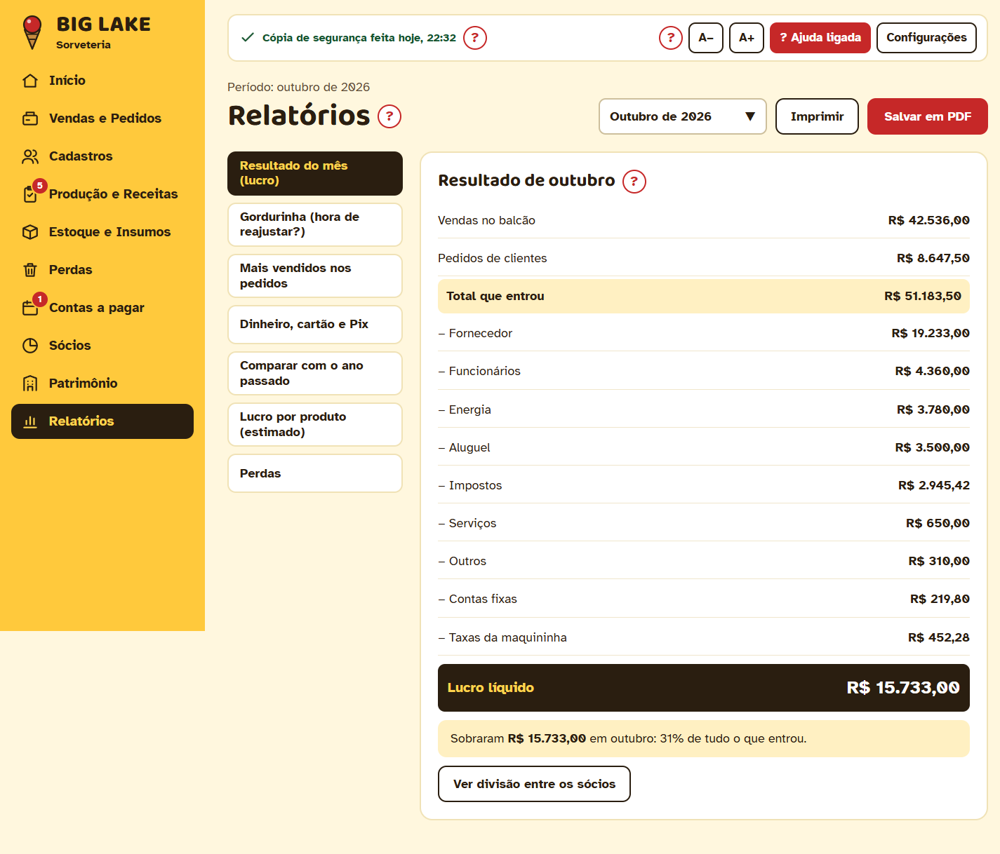<br><sub><b>Resultado do mês</b>: tudo o que entrou menos tudo o que saiu.</sub></td>
    <td>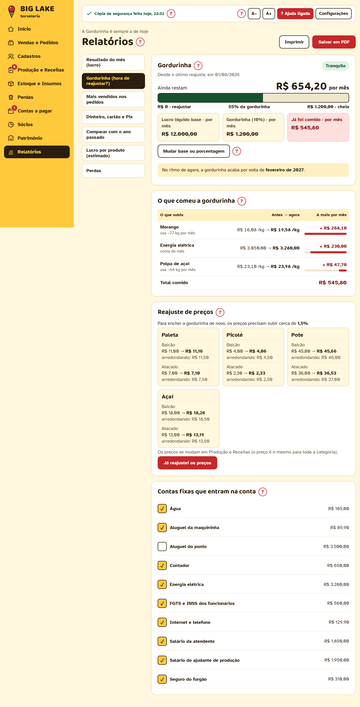<br><sub><b>Gordurinha</b>: quanto da margem os aumentos de custo já comeram.</sub></td>
  </tr>
  <tr>
    <td>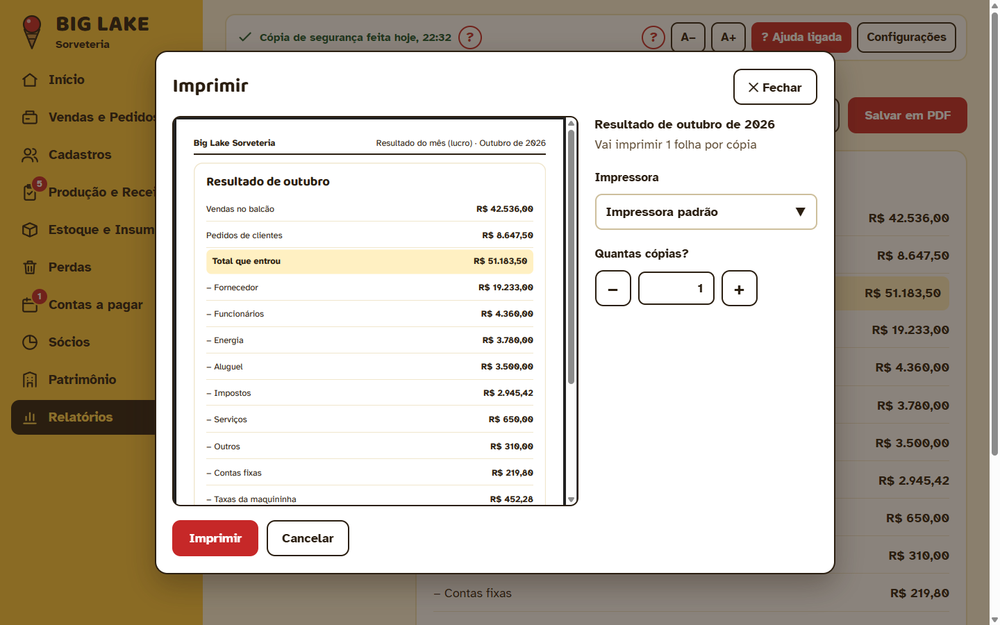<br><sub><b>Imprimir</b>: prévia da folha A4 dentro do programa.</sub></td>
    <td>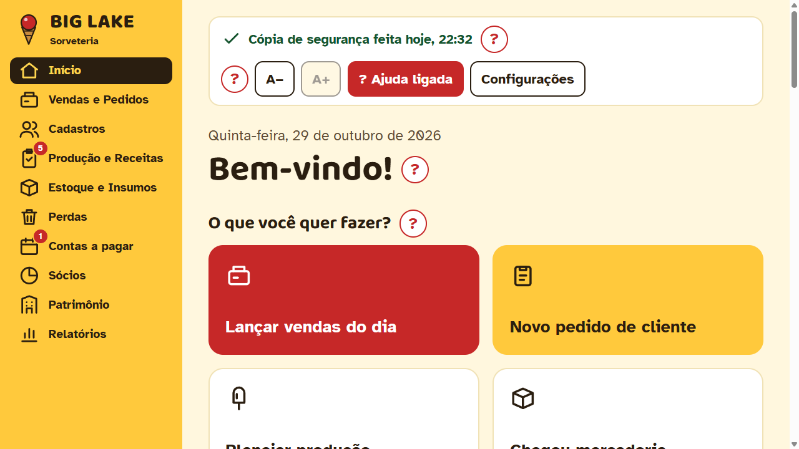<br><sub><b>Acessibilidade</b>: letra no máximo (130%) numa tela de 1280×720, sem rolagem horizontal.</sub></td>
  </tr>
</table>

Todas as 25 capturas estão em [`portfolio/imagens/`](portfolio/imagens/). Os dados são de uma loja de exemplo fictícia, com 5 meses de movimento.

## Tecnologias

| Camada | Escolha | Por quê |
|---|---|---|
| App desktop | **Electron 44** | Instalador `.exe` para Windows, tudo embutido, sem depender de internet |
| Interface | **React 19** + **TypeScript 6** (estrito) | Componentes próprios no padrão do protótipo aprovado: lista suspensa, modal, campos de dinheiro e data |
| Dados na tela | TanStack Query | Cache e atualização das telas depois de cada gravação |
| Banco | **SQLite** pelo `node:sqlite` nativo do Node | Um arquivo local, transações, sem módulo nativo para compilar |
| Validação | Zod | Toda chamada da tela é validada no processo principal |
| Build | electron-vite (Vite 8), electron-builder (NSIS) | Build reproduzível e instalador em português |
| Testes | **Vitest** e **Playwright** | Unidade, integração com banco real e ponta a ponta no programa construído |
| Qualidade | ESLint, Prettier | Rodam no `npm run verificar`, junto com os tipos e os testes |

## Decisões técnicas que valem destacar

- **Dinheiro nunca em ponto flutuante.** Valores em centavos inteiros e custos unitários com 4 casas (inteiros ×10.000). Os cálculos de custo, margem, divisão dos sócios e reajuste de preços começaram por testes com números de referência.
- **Regras de negócio isoladas.** `src/dominio/` é TypeScript puro: sem Electron, Node, React nem `Date` (o ESLint bloqueia). Cobertura mínima de 90%.
- **Arquitetura em camadas e segura.** A interface não acessa o banco: passa por um contrato tipado (`src/compartilhado/contrato.ts`), uma ponte (`preload`) e o processo principal, que valida tudo antes de gravar.
- **Nada se perde.** Cada ação confirmada é gravada na hora, numa transação. Há migrações versionadas com cópia de segurança antes de cada uma, cópia ao abrir e ao fechar (no computador e no pen drive), conferência de integridade do banco e histórico legível ("Mudou o preço da Paleta de R$ 10,00 para R$ 10,50").
- **Offline de verdade.** Fontes, ícones e bibliotecas vão dentro do instalador. Relatórios e comprovantes viram PDF e são impressos sem depender de serviço externo.
- **Acessível para o usuário real.** Letra base de 18 px com A−/A+ (80% a 130%), botões de pelo menos 46 px, alto contraste e um teste automático que garante que **nenhuma tela** cria rolagem horizontal, em nenhum tamanho de tela ou de letra.
- **Decisões registradas.** Cada regra decidida com o cliente virou um registro curto (data, pergunta, decisão e motivo) em [`docs/DECISOES.md`](docs/DECISOES.md): são mais de 90.

## Qualidade e testes

| Tipo | Quantidade | O que cobre |
|---|---|---|
| Unidade (Vitest) | parte dos 413 | Cálculos de dinheiro, datas, regras de estoque, lucro, Gordurinha |
| Integração (Vitest) | parte dos 413 | Serviços contra um banco SQLite real em pasta temporária, inclusive **10 anos de dados** para medir desempenho |
| Ponta a ponta (Playwright) | 80 | Abre o programa construído e clica como o usuário: fluxos completos, impressão, cópia de segurança, restauração e layout em 1280×720 com letra a 130% |

Antes de entregar a versão 0.9.1, fiz também um **teste exploratório simulando 2 meses de uso real**: o programa foi aberto dia após dia, com a data do relógio avançando, para lançar vendas, pedidos, compras, produção, contas e retiradas, além de uma bateria de tentativas de quebrar o sistema. Os números bateram exatamente com uma conta feita à parte, e o teste achou problemas que os testes por tela não pegavam (clique duplo gravando em dobro, texto inválido virando zero, compras fora do lucro). Todos foram corrigidos com testes novos.

## Como rodar

Precisa do **Node 24** no Windows.

```bash
npm install
npm run dev          # abre o programa em desenvolvimento
npm run exemplo      # (opcional, com o programa fechado) enche o banco com a loja de exemplo
npm run verificar    # tipos, lint, testes de unidade/integração e ponta a ponta
npm run instalador   # gera dist/BigLake-Gestao-Instalador-<versão>.exe
```

<details>
<summary>Todos os comandos e variáveis de ambiente</summary>

| Comando | O que faz |
|---|---|
| `npm install` | Instala as dependências |
| `npm run dev` | Abre o programa em desenvolvimento (recarrega sozinho) |
| `npm run tipos` | Checagem de tipos (`tsc --strict`) |
| `npm run lint` | ESLint |
| `npm run formatar` | Prettier (confira o que mudou antes de guardar) |
| `npm run teste` | Testes de unidade, integração e desempenho (Vitest) |
| `npm run teste:cobertura` | Idem, com cobertura (mínimo 90% em `src/dominio/`) |
| `npm run e2e` | Constrói e roda os testes ponta a ponta e de "sem rolagem horizontal" (Playwright) |
| `npm run verificar` | Tudo acima, em sequência: **rodar antes de entregar** |
| `npm run exemplo` | Enche um banco vazio com uma loja de exemplo de 5 meses (programa fechado) |
| `npm run manual` | Tira as capturas de tela e gera `recursos/manual/Manual-BIG-LAKE.pdf` a partir de `manual.html` |
| `npm run instalador` | Gera `dist/BigLake-Gestao-Instalador-<versão>.exe` (NSIS, x64, pt-BR), com o manual junto |
| `npm run icone` | Regera `recursos/icone.png` a partir do logo |

Variáveis para testes: `BIGLAKE_HOJE=dd/mm/aaaa` (data fixa), `BIGLAKE_DADOS` (pasta do banco), `BIGLAKE_COPIAS` (pasta das cópias), `BIGLAKE_PENDRIVE` (pasta que faz o papel do pen drive; vazio = sem pen drive). Os testes sempre usam pastas temporárias.

Dados reais (no computador da loja): banco em `%APPDATA%\BigLake\biglake.db`, cópias em `Documentos\BigLake\Backups` e `<pen drive>\BigLake-Backups`, log em `%APPDATA%\BigLake\logs`.

</details>

## Estrutura

```
src/dominio/       regras e cálculos puros (dinheiro, lucro, Gordurinha…), com testes
src/main/          processo principal: banco, migrações, serviços, IPC, cópias, impressão/PDF
src/preload/       ponte segura entre a tela e o processo principal (window.api)
src/compartilhado/ contrato entre as duas partes (tipos e canais)
src/renderer/      telas (React)
testes/integracao/ serviços contra um banco de verdade (pasta temporária), inclusive 10 anos de dados
testes/e2e/        o programa construído, clicado como o usuário clicaria
testes/manual/     o gerador do manual do usuário
recursos/          ícone e manual do usuário (PDF)
docs/              especificação, decisões, roteiros de teste manual e de aceitação
prototipo/         o protótipo navegável aprovado pelo cliente (referência das telas)
```

Mais documentação: [`docs/instalacao.md`](docs/instalacao.md) (instalar e atualizar na loja) e o manual do usuário em [`recursos/manual/Manual-BIG-LAKE.pdf`](recursos/manual/Manual-BIG-LAKE.pdf).

## Como foi feito

O projeto seguiu um ciclo de time pequeno: levantamento das regras com o cliente, **protótipo navegável aprovado antes do código**, entregas em fatias pequenas (cada uma com tela, regra, banco e testes) e um roteiro de aceitação com o usuário final. O desenvolvimento contou com o apoio do **Claude Code** (assistente de programação com IA), guiado pelas regras e pelo fluxo descritos em [`CLAUDE.md`](CLAUDE.md).

## Situação

Versão **0.9.1**: todas as funcionalidades prontas, em teste na loja com o usuário final antes da versão 1.0.0.
